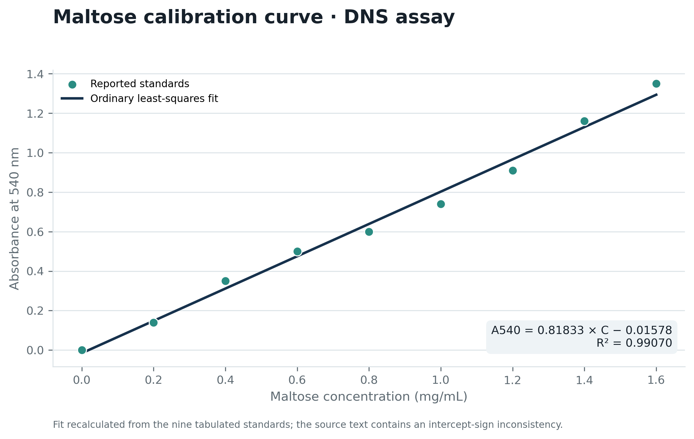
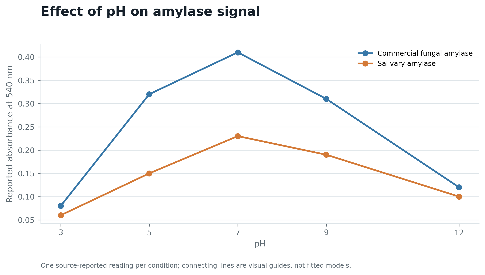
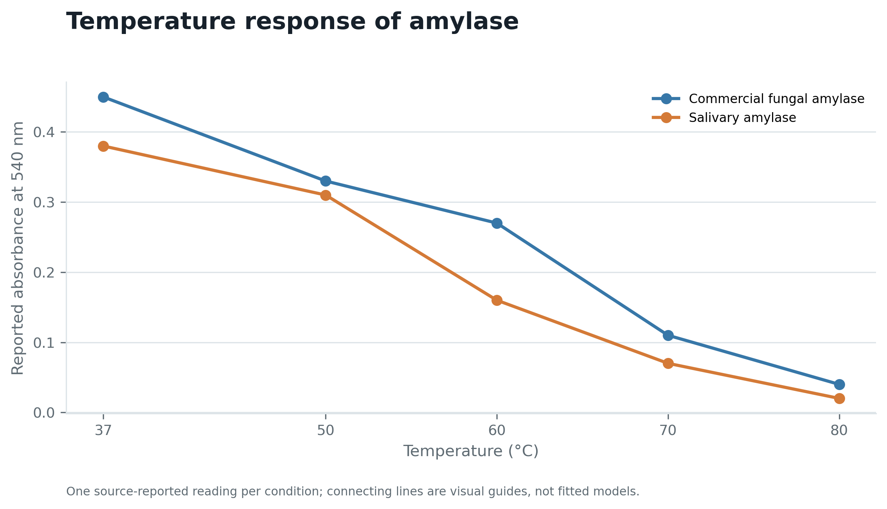
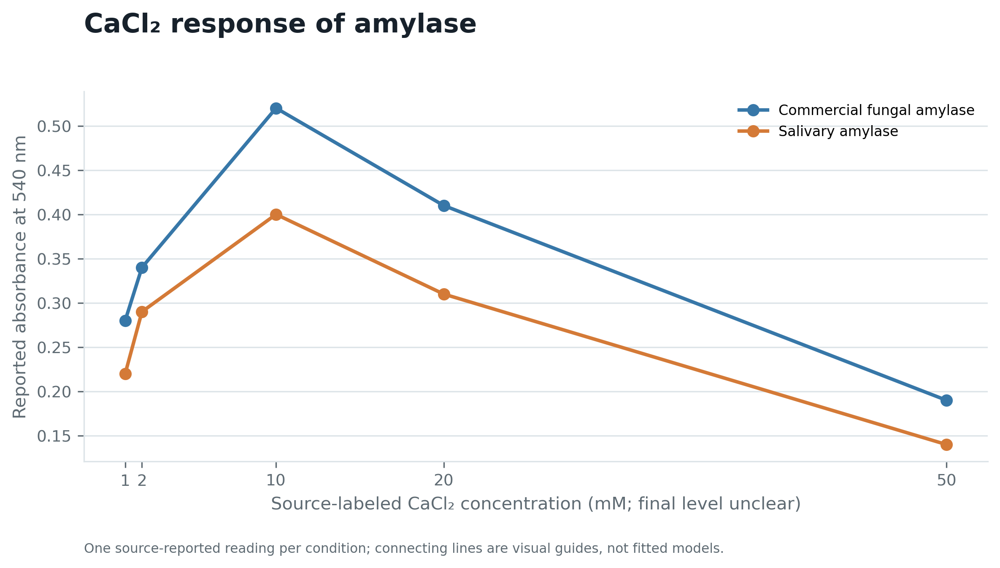
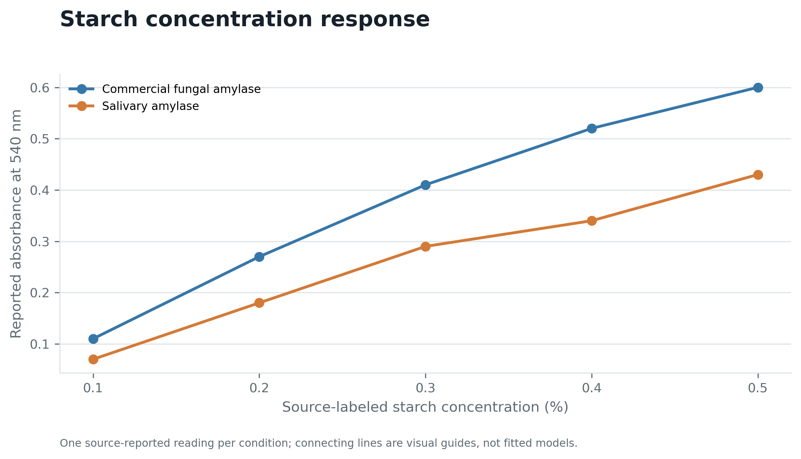
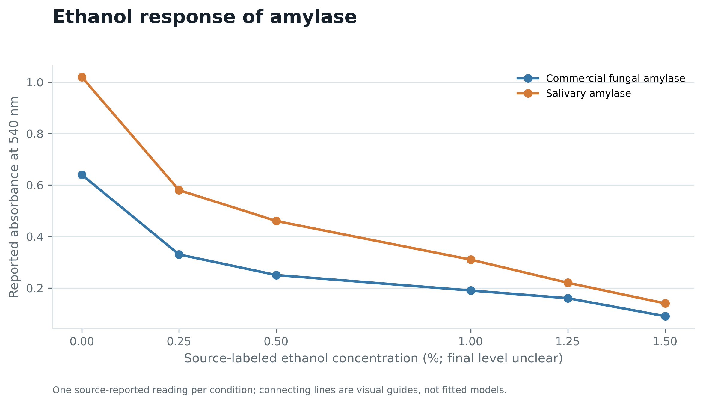

# Amylase activity under physicochemical conditions

This repository turns the supplied DNS colorimetric-assay report into a reproducible, transparent analysis package. It includes the transcribed standard curve and enzyme-assay readings, six generated figures, a report, validation tests, and scripts that regenerate the outputs.

## Main reported patterns

- The source readings peak at pH 7 for both enzyme preparations.
- The highest measured absorbance occurs at 37°C, then declines across the tested temperatures.
- Both preparations peak at the source-labeled 10 mM CaCl₂ condition.
- Absorbance rises across the tested 0.1–0.5% starch range; no plateau is observed within that range.
- Absorbance decreases across the source-labeled 0–1.5% ethanol range.

These are single reported measurements per condition. The figures show absorbance at 540 nm, not statistically estimated enzyme rates.

## Figure gallery

Each plot uses one source-reported reading per condition. Connecting lines are visual guides; they are not fitted dose-response models.

<table>
  <tr>
    <td width="50%">
      <strong>Figure 1. Maltose calibration curve</strong><br>
      <a href="figures/figure_01_maltose_standard_curve.png"></a>
    </td>
    <td width="50%">
      <strong>Figure 2. pH response</strong><br>
      <a href="figures/figure_02_ph_response.png"></a>
    </td>
  </tr>
  <tr>
    <td width="50%">
      <strong>Figure 3. Temperature response</strong><br>
      <a href="figures/figure_03_temperature_response.png"></a>
    </td>
    <td width="50%">
      <strong>Figure 4. CaCl₂ response</strong><br>
      <a href="figures/figure_04_calcium_chloride_response.png"></a>
    </td>
  </tr>
  <tr>
    <td width="50%">
      <strong>Figure 5. Starch concentration response</strong><br>
      <a href="figures/figure_05_starch_response.png"></a>
    </td>
    <td width="50%">
      <strong>Figure 6. Ethanol response</strong><br>
      <a href="figures/figure_06_ethanol_response.png"></a>
    </td>
  </tr>
</table>

## Rebuild the figures, derived table, and PDF report

Requires Python 3.10+ and Matplotlib:

```bash
python -m pip install -r requirements.txt
python scripts/build_analysis.py
python -m unittest discover -s tests -v
```

Outputs:

- `figures/` — standard curve and five condition-response plots in PNG and PDF
- `results/recalculated_product_yield.csv` — maltose-equivalent estimates calculated from the observed standards and absorbance data
- `reports/final_report.pdf` and `reports/final_report.md` — final report

## Interpretation boundaries

The original PDF reports one reading per condition, so there are no error bars or statistical tests. The source has inconsistent signs for the standard-curve intercept; the included script fits the nine observed standard points and records the result. The source PDF itself and a full extracted transcript are not included.

See `docs/DATA_PROVENANCE_AND_LIMITATIONS.md` before interpreting the concentration estimates or comparing enzyme preparations.
