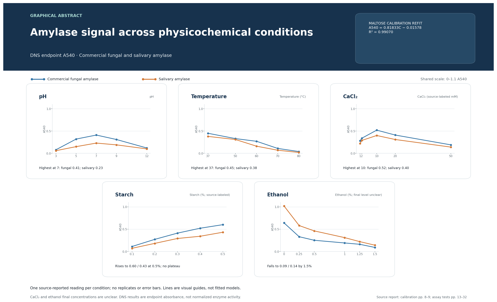

# Characterization of amylase activity using the DNS colorimetric assay

## Executive summary

The supplied project report records a maltose standard curve and endpoint absorbance readings for commercial fungal and salivary amylase under five conditions: pH, temperature, calcium chloride, starch concentration, and ethanol. The direct results show the largest absorbance at pH 7 and 37°C, a maximum at the source-labeled 10 mM CaCl₂ condition, rising signal across the tested starch range, and decreasing signal as the source-labeled ethanol concentration increases.

These are descriptive patterns from one reported reading per condition. No replicates, uncertainty estimates, or raw instrument exports were provided. The figures therefore plot source-reported A540 values without error bars and make no significance claims.

## Graphical abstract

The five panels share an A540 scale. Points are the source-reported readings; connecting lines are visual guides only. The abstract does not imply replicates, fitted response models, or normalized enzyme activity.

## Calibration

The nine standards reported on page 8 span 0–1.6 mg/mL maltose. Refitting those points by ordinary least squares gives `A540 = 0.81833 × C − 0.01578`, with `R² = 0.99070`. This is consistent with the negative-intercept equation shown in the standard-curve graph and in the later calculation, but the source also prints a positive-intercept equation. The discrepancy is documented in `docs/DATA_PROVENANCE_AND_LIMITATIONS.md`.

The analysis plots direct absorbance measurements. A separate generated table contains recalculated maltose-equivalent concentrations. The source-reported concentration table is preserved alongside those recalculations; the ethanol values include differences larger than rounding, so they should be reconciled against the original instrument/calculation records.

## Results

### pH

Both preparations reached their highest recorded A540 at pH 7: 0.41 for commercial fungal amylase and 0.23 for salivary amylase. The signal was lower at pH 3, 5, 9, and 12. The source used sodium acetate buffer for pH 3 and 5 and potassium phosphate buffer for pH 7, 9, and 12, so pH effects are partly confounded with buffer chemistry.

### Temperature

The highest readings occurred at 37°C (0.45 commercial; 0.38 salivary). Both series declined at higher temperatures, reaching 0.04 and 0.02, respectively, at 80°C. This supports a descriptive loss of endpoint signal with increasing temperature in this assay; without replicates it does not quantify uncertainty or establish a statistically significant difference between preparations.

### Calcium chloride

Both series peaked at the source-labeled 10 mM condition (A540 0.52 commercial; 0.40 salivary) and were lower at 20 and 50 mM. The method adds 0.5 mL of a CaCl₂ solution to the reaction, but the report does not clarify whether table labels are stock or final reaction concentrations.

### Starch concentration

A540 rose from 0.1% to 0.5% starch for both preparations (0.11 to 0.60 commercial; 0.07 to 0.43 salivary). The top of the tested range is still increasing, so the data do not show a clear saturation plateau and are insufficient to estimate Michaelis–Menten parameters.

### Ethanol

Across the source-labeled 0–1.5% ethanol conditions, A540 fell from 0.64 to 0.09 for commercial fungal amylase and from 1.02 to 0.14 for salivary amylase. This is a descriptive reduction in measured reducing-sugar signal. Final reaction ethanol concentrations are not explicitly distinguished from prepared-solution concentrations in the source.

## Interpretation and limitations

- The DNS assay measures reducing sugars; converting A540 through a maltose calibration yields maltose-equivalent concentration, not a molecule-specific maltose measurement.
- Each condition has a single listed observation. There are no replicate values, standard deviations, confidence intervals, or inferential tests.
- The endpoint after a fixed incubation is not normalized to enzyme mass or expressed as a validated activity unit. The commercial and saliva preparations also have different stated preparation/dilution, so absolute signal does not establish intrinsic catalytic efficiency.
- Buffer composition changes across the pH range; calcium and ethanol concentration definitions are ambiguous; no raw instrument exports were supplied.
- The standard-curve intercept sign is inconsistent in the source report, and ethanol concentration calculations do not all match the reported calibration equation within rounding.

## Conclusion

The supplied measurements are consistent with higher A540 near pH 7 and 37°C, a response maximum at the source-labeled 10 mM CaCl₂ condition, rising signal over the tested starch range, and lower signal at higher source-labeled ethanol levels. These are preliminary descriptive results. Replicated, blank-corrected, concentration-normalized assays with recorded final reaction conditions are needed before making statistical or kinetic claims.

## Sources and reproducibility

Values were transcribed from `enzymology_1793005839159.pdf`: standards (page 8); pH (pages 13–14); temperature (pages 16–18); CaCl₂ (pages 21–23); starch (pages 26–27); ethanol (pages 31–32). Run `python scripts/build_analysis.py` to regenerate the graphical abstract, figures, derived concentration table, and PDF report.
